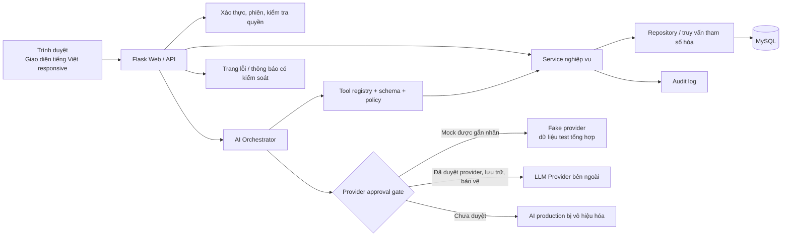

# Thiết kế sản phẩm — Hệ thống quản lý chăn nuôi có AI Agent

## 1. Mục đích và phạm vi

Tài liệu này đặc tả sản phẩm ở mức đủ để duyệt trước khi bắt đầu triển khai. Hệ thống hướng tới chủ trang trại, nhân viên chăm sóc và quản trị viên; hỗ trợ bò, lợn, gia cầm và mở rộng loài qua dữ liệu danh mục, không cần thêm nhánh xử lý riêng cho từng loài.

Phạm vi MVP là **một trang trại**; các bảng và policy vẫn mang `farm_id` để có thể mở rộng nhiều trang trại sau này:

- Đăng nhập, quản lý người dùng và phân quyền theo trang trại.
- Quản lý loài, vật nuôi/nhóm vật nuôi, chuồng trại và chuyển đàn.
- Nhật ký sức khỏe, lịch và kết quả tiêm phòng.
- Danh mục thức ăn, giao dịch tồn kho và cảnh báo.
- Dashboard tổng hợp, danh sách cảnh báo và thao tác xác nhận đã xử lý.
- AI Agent truy vấn dữ liệu chỉ qua các công cụ nghiệp vụ được định nghĩa rõ.
- Audit log, xử lý lỗi, kiểm thử, tài liệu và kịch bản demo.

Ngoài phạm vi MVP: chẩn đoán thú y tự động, kê đơn/điều trị, IoT, dự báo bằng mô hình riêng, mua bán, kế toán, tối ưu khẩu phần tự động, ứng dụng di động native và RAG/ChromaDB. Chỉ xem xét mở rộng sau khi có nhu cầu, dữ liệu và người chịu trách nhiệm chuyên môn.

## 2. Người dùng và nhu cầu

| Vai trò | Mục tiêu chính | Hành động điển hình |
|---|---|---|
| Chủ trang trại | Nắm tình hình đàn, sức khỏe, thức ăn và việc cần xử lý | Xem dashboard/cảnh báo, tra cứu dữ liệu, xem audit trong phạm vi được cấp |
| Nhân viên chăm sóc | Ghi nhận công việc chính xác, tra lịch và thông tin chăm sóc | Xem dashboard/cảnh báo; cập nhật hồ sơ và event nghiệp vụ theo permission; ghi kết quả tiêm, tiêu thụ thức ăn; tiếp nhận cảnh báo |
| Quản trị viên nền tảng | Vận hành tài khoản và cấu hình hệ thống | Quản lý tài khoản/cấu hình; không mặc nhiên đọc dữ liệu nghiệp vụ |

Nhân viên chỉ truy cập chức năng và dữ liệu được cấp phép. Quản trị viên nền tảng chỉ được truy cập dữ liệu nghiệp vụ khi có quyền rõ ràng, giới hạn phạm vi/thời hạn và audit đầy đủ.
Chủ farm có thể cấp/thu hồi permission riêng cho delegate theo từng chức năng; nhân viên không tự cấp quyền. Các quyền được kiểm tra tại backend mỗi request và không làm rộng farm scope.

MVP theo dõi bò/lợn ưu tiên từng cá thể; gia cầm ưu tiên đàn/lô. Mô hình vẫn hỗ trợ cá thể thuộc mọi loài. Mỗi con vật phải chỉ thuộc một đơn vị theo dõi hiện hành để dashboard không đếm trùng.

## 3. Luồng sản phẩm

### 3.1 Đăng nhập và điều hướng

1. Người dùng mở trang đăng nhập tiếng Việt, nhập thông tin xác thực.
2. Máy chủ xác minh mật khẩu đã băm, trạng thái tài khoản và phạm vi trang trại.
3. Nếu hợp lệ, tạo phiên an toàn; nếu không, hiển thị thông báo chung, không tiết lộ tài khoản có tồn tại hay không.
4. Điều hướng đến dashboard phù hợp với vai trò; mọi request tiếp tục được kiểm tra quyền ở máy chủ.
5. Đăng xuất hủy phiên. Tài khoản bị khóa hoặc phiên hết hạn phải bị từ chối ở request tiếp theo.

### 3.2 Quản lý nghiệp vụ

1. Người dùng có quyền chọn trang trại (nếu được phân nhiều trang trại).
2. Tạo/sửa thông tin chuồng, vật nuôi/nhóm, sức khỏe, tiêm phòng hoặc giao dịch thức ăn.
3. Máy chủ xác thực schema, khóa ngoại, ngày tháng, đơn vị, số lượng và quyền truy cập.
4. Ghi thay đổi nghiệp vụ trong transaction; ghi audit thành công/thất bại theo chính sách.
5. Quy tắc cảnh báo cập nhật danh sách cảnh báo; giao diện hiển thị trạng thái mới và lỗi có thể hành động.

Nhân viên được xem và tạo/cập nhật hồ sơ, ghi event chăm sóc, biến động đàn, nhập/tách/gộp/chuyển đổi tracking và chuyển chuồng trong workflow có permission, kiểm tra backend và farm scope. Mọi thay đổi số lượng phải qua event/transaction; lỗi phải rollback toàn bộ, số lượng không âm/không hợp lệ và không được đếm trùng. Không xóa cứng hồ sơ/lịch sử, tự điều chỉnh kho/sức chứa/ngưỡng, tự duyệt ngoại lệ hoặc tự cấp quyền. Các action nhạy cảm dưới đây vẫn chỉ dành cho owner/delegate được cấp permission cụ thể.

### 3.3 Dashboard và cảnh báo

Dashboard hiển thị tổng quan theo trang trại và quyền: tổng số đầu con, số đơn vị theo dõi, các lịch tiêm sắp đến/quá hạn, ghi nhận sức khỏe cần theo dõi, tồn kho/cảnh báo tồn kho, sức chứa chuồng và việc chưa xử lý. Tổng đầu con được tính trên các đơn vị hiện hành, không tính đơn vị đã tách/gộp/ngừng theo dõi: cá thể đóng góp 1, đàn/lô đóng góp `head_count`. Chuyển đổi giữa đàn và cá thể phải cập nhật đơn vị nguồn/đích nguyên tử, bảo toàn tổng số; chỉ cộng các đơn vị hiện hành. Số liệu phải đối chiếu với truy vấn nghiệp vụ. Cảnh báo là nhắc việc theo quy tắc, không phải kết luận y khoa.

### 3.4 Hội thoại AI

1. Người dùng mở mục Trợ lý AI; giao diện nêu rõ AI có thể truy vấn những loại dữ liệu nào và giới hạn tư vấn.
2. Backend tái sử dụng session hiện tại; user/farm lấy từ `g.user`/`g.farm`, không nhận farm ID từ trình duyệt. Mỗi tool kiểm tra lại membership đang hoạt động.
3. Trong `AGENT_MODE=mock`, một bộ điều phối quy tắc nhận diện intent tiếng Việt và gọi tối đa 3 tool đã đăng ký. Đây là chế độ mô phỏng không sử dụng LLM.
4. Các tool chỉ đọc, xác thực schema, giới hạn danh sách 10 dòng và truy vấn các hàng có `synthetic_dataset_id` thuộc cùng farm. Không có SQL do người dùng cung cấp; audit thành công chỉ ghi actor/farm/tên tool, không ghi câu hỏi hoặc kết quả.
5. Phản hồi tổng hợp từ DTO công cụ, gắn nhãn **"MÔ PHỎNG"**, nguồn tool, thời điểm và phạm vi; lịch dự kiến được trình bày riêng với outcome thực tế.
6. Giao diện `/assistant` dùng POST, CSRF, trạng thái unavailable/empty/error; kết quả không được lưu thành lịch sử hội thoại.
7. `AGENT_MODE` mặc định `disabled`; `mock` chỉ hợp lệ trong `APP_ENV=test|demo`. `provider` chưa được triển khai và luôn báo chưa khả dụng. Không có outbound LLM.

### 3.5 Ma trận phân quyền đề xuất

Mọi quyền được cưỡng chế ở backend cho mọi API và AI tool; ẩn nút trên giao diện không thay thế kiểm tra quyền. Trong MVP chỉ có một trang trại, nhưng `*` là phạm vi `farm_id` được gán và sẽ tiếp tục được kiểm tra khi mở rộng nhiều trang trại. Áp dụng nguyên tắc mặc định từ chối và phân quyền theo chức năng. Quản trị viên nền tảng mặc định không có quyền đọc nghiệp vụ.

| Tài nguyên/hành động | Chủ trang trại* | Nhân viên chăm sóc* | Quản trị viên hệ thống |
|---|---|---|---|
| Dashboard và cảnh báo | Đọc; đóng/mở lại cảnh báo có lý do và audit | Đọc theo scope; được acknowledge và thêm ghi chú; không đóng/mở lại | Từ chối dữ liệu nghiệp vụ mặc định |
| Người dùng và vai trò trang trại | Quản lý thành viên trong farm; không tự cấp system admin | Từ chối | Quản lý tài khoản nền tảng; không tự động được gán vào farm |
| Cấu hình trang trại/ngưỡng cảnh báo | Đọc/thay đổi cấu hình nghiệp vụ; ngưỡng sức khỏe cần nguồn/xác nhận | Chỉ đọc hoặc thay đổi đúng cấu hình được cấp | Quản lý cấu hình nền tảng; không tự đặt ngưỡng y tế |
| Danh mục loài/giống dùng chung | Đọc | Đọc | Quản lý danh mục dùng chung, có audit |
| Chuồng trại | Đọc/thêm/sửa/ngừng hoạt động; cấu hình capacity và phê duyệt ngoại lệ theo permission riêng | Đọc/cập nhật trường được cấp; không tự đổi capacity; chỉ delegate được cấp rõ permission mới được gửi/duyệt ngoại lệ | Từ chối; grant hỗ trợ chỉ đọc, có scope/thời hạn/lý do |
| Vật nuôi/nhóm | Đọc/thêm/sửa/chuyển/tách/gộp/ngừng theo dõi; mọi đổi số lượng qua event | Đọc/tạo/cập nhật và ghi event nghiệp vụ hợp lệ theo permission; không xóa cứng, không vượt capacity hoặc điều chỉnh số lượng không hợp lệ | Từ chối; grant hỗ trợ chỉ đọc |
| Nhật ký sức khỏe và tiêm phòng | Đọc/ghi correction có audit; tạo/sửa/hủy lịch tiêm và duyệt ngưỡng theo permission riêng | Đọc; ghi nhận kết quả thực tế (đã tiêm/chưa thực hiện/hoãn/cần xác minh); không tạo/sửa/hủy lịch nếu chưa có quyền riêng | Từ chối; grant hỗ trợ chỉ đọc |
| Danh mục thức ăn và ngưỡng kho | Đọc/thêm/sửa/ngừng hoạt động; quản lý conversion/ngưỡng theo quyền | Đọc; không điều chỉnh tồn, conversion hoặc ngưỡng nếu không có quyền riêng | Từ chối; grant hỗ trợ chỉ đọc |
| Giao dịch thức ăn | Đọc/nhập/điều chỉnh có lý do; không cho tồn âm | Đọc và ghi nhận tiêu thụ; không tự nhập kho/điều chỉnh/xóa giao dịch | Từ chối; grant hỗ trợ chỉ đọc |
| Audit nghiệp vụ/hội thoại | Đọc audit trong farm; chỉ xem hội thoại của mình | Không đọc audit; chỉ xem hội thoại của mình | Audit nghiệp vụ chỉ theo grant hợp lệ; không sửa/xóa |
| Grant hỗ trợ admin nền tảng | Không mặc định cấp; không tự cấp/phê duyệt | Không có quyền | Mặc định disabled; chỉ authority độc lập đã được chỉ định qua vận hành có audit mới được quyết định; admin không tự gán quyền, tự duyệt, tự cấp; người cấp và người nhận khác nhau |
| Yêu cầu ngoại lệ sức chứa | Owner/delegate có permission gửi; owner/delegate có quyền phê duyệt riêng; người gửi không tự duyệt | Không có quyền mặc định; chỉ delegate được cấp rõ permission mới được gửi/duyệt | Không mặc định có quyền gửi/duyệt |
| Policy retention/purge | Xem audit farm; không trực tiếp chạy purge | Không có quyền đọc audit/purge | Admin nền tảng cấu hình policy; purge disabled ở backend, không user/admin nào gọi trực tiếp; chỉ job identity riêng sau khi duyệt lịch chạy, backup/hold |
| AI tools tra cứu | Tool read-only theo quyền chủ farm | Kế thừa đúng permission của user, farm scope và giới hạn tool | Mặc định từ chối; grant chỉ đọc theo scope |
| Thao tác ghi qua AI | Từ chối trong MVP | Từ chối trong MVP | Từ chối |
| Quản trị nền tảng/cấu hình triển khai | Từ chối | Từ chối | Cho phép theo quyền vận hành; secrets không hiển thị qua UI |

Quy tắc bổ sung: mặc định từ chối; không có quyền truy cập chéo `farm_id`; không cho nhân viên tự cấp vai trò/permission. Grant hỗ trợ mặc định không tồn tại và backend từ chối khi authority độc lập chưa được chỉ định/xác minh; authority phải được audit; người cấp khác người nhận, admin không tự gán quyền hoặc tự duyệt yêu cầu. Grant chỉ đọc, giới hạn farm/dữ liệu, lý do, người cấp/nhận và thời hạn, kiểm tra ở mỗi request, audit cấp/từ chối/dùng/thu hồi. Correction không xóa lịch sử gốc. Ngoại lệ sức chứa chỉ owner/delegate có permission được gửi yêu cầu hoặc phê duyệt; người gửi không tự duyệt. Request không thực thi nghiệp vụ; khi duyệt/thực hiện phải ghi lý do, actor và thời điểm, tính lại occupancy trong transaction. AI không được thực hiện action cảnh báo, lịch tiêm, kho hoặc ngoại lệ.

### 3.6 Bootstrap quản trị viên lần đầu

- Dùng quy trình bootstrap một lần, chỉ khi chưa có admin nền tảng; mặc định là lệnh quản trị cục bộ thay vì endpoint công khai.
- Bí mật được nhập tương tác an toàn hoặc cấp qua environment; không ghi log, seed, source hay Git.
- Tạo admin và đánh dấu bootstrap hoàn tất atomically; nếu admin đã tồn tại, lệnh từ chối. Hash mật khẩu; không có mật khẩu mặc định.
- Sau bootstrap, không thể dùng lại để tạo/chiếm quyền admin. Test cả khởi tạo hợp lệ, lần hai, thiếu thông tin xác thực và lỗi giữa chừng.

## 4. Kiến trúc đề xuất

### Thành phần và nguyên tắc

- **Flask modular monolith:** một ứng dụng, tách blueprint, service, repository và model để dễ phát triển/test; chưa cần microservices.
- **MySQL:** cơ sở dữ liệu triển khai chính. Migration có phiên bản; khóa ngoại, chỉ mục và transaction cho thay đổi liên quan.
- **SQLite:** chỉ dùng nếu logic, kiểu dữ liệu, constraint và test thực sự tương thích. Nếu có khác biệt ảnh hưởng kết quả, dùng MySQL trong integration test thay vì tuyên bố SQLite chứng minh tương thích.
- **Giao diện:** HTML/CSS/JavaScript, ưu tiên khả năng truy cập, bố cục responsive và tiếng Việt; chưa cần SPA/framework frontend.
- **AI:** adapter nhỏ, tool registry nội bộ và mock mode được gắn nhãn; không gửi dữ liệu thật đến LLM ngoài trước khi duyệt nhà cung cấp, chính sách lưu trữ và biện pháp bảo vệ dữ liệu. API key chỉ qua secret configuration, không đưa vào frontend, log hoặc Git.
- **Triển khai:** Docker Compose cho ứng dụng và MySQL khi phù hợp; secrets không hard-code trong compose. Dữ liệu demo tách biệt dữ liệu thật.
- **Không dùng RAG ở MVP:** chỉ thêm khi có corpus có quyền sử dụng, yêu cầu truy hồi tài liệu và quy trình kiểm chứng trích dẫn.

## 5. Yêu cầu phi chức năng

- **Bảo mật:** hash mật khẩu bằng helper được duy trì; cookie phiên HttpOnly, Secure khi HTTPS, SameSite; CSRF cho form thay đổi dữ liệu; giới hạn thử đăng nhập; truy vấn tham số hóa; không lộ stack trace cho người dùng.
- **Phân tách dữ liệu:** mọi truy vấn nghiệp vụ phải ràng buộc farm scope; không tin `farm_id` do client hoặc LLM tự cung cấp nếu chưa đối chiếu quyền.
- **Khả dụng và lỗi:** lỗi DB/provider được log theo correlation ID, trả thông báo an toàn và mã trạng thái phù hợp; không có fallback thành công giả.
- **Audit/retention:** đề xuất demo giữ audit 12 tháng, hội thoại AI 90 ngày; đây là giả định cấu hình cho môi trường demo, không phải kết luận pháp lý. Quyền đọc/xóa giới hạn, purge theo chính sách cấu hình và ghi audit kết quả purge; tránh lưu mật khẩu, token, API key hoặc nội dung nhạy cảm không cần thiết.
- **Sức chứa và y tế:** sức chứa cấu hình theo số đầu con; vượt ngưỡng cảnh báo và chỉ ngoại lệ được cấp quyền, có lý do/audit. Cảnh báo sức khỏe chỉ theo ngưỡng có nguồn hoặc được người có thẩm quyền xác nhận; AI không đặt ngưỡng y tế.
- **Khả năng sử dụng:** nhãn/validation tiếng Việt, thông báo lỗi cụ thể, bảng có trạng thái rỗng, thao tác chính dùng được ở màn hình nhỏ.
- **Khả năng mở rộng:** loài và giống là danh mục; đơn vị thức ăn được định danh; tránh điều kiện nghiệp vụ hard-code riêng cho bò/lợn/gia cầm.

## 6. Giả định và quyết định cần xác nhận

| Mã | Giả định/đề xuất hiện tại | Cần xác nhận |
|---|---|---|
| A1 | MVP một trang trại, schema mọi dữ liệu nghiệp vụ có `farm_id` | Đã được người dùng xác nhận |
| A2 | Admin nền tảng không có quyền nghiệp vụ mặc định; grant chỉ đọc, scoped, có hạn và audit | Đã chốt: không có authority/grant mặc định; chỉ authority độc lập được chỉ định qua vận hành có audit mới cấp/thu hồi; admin không tự gán quyền/tự duyệt; người cấp khác người nhận |
| A3 | Nhân viên thao tác theo workflow và permission; không xóa cứng, tự điều chỉnh kho/capacity/ngưỡng hoặc tự duyệt ngoại lệ | Đã chốt: nhân viên ghi event nghiệp vụ, acknowledgement cảnh báo, kết quả tiêm và tiêu thụ thức ăn; không đóng cảnh báo, sửa lịch tiêm, nhập kho hoặc điều chỉnh tồn nếu chưa có quyền riêng |
| A4 | Bò/lợn ưu tiên cá thể; gia cầm ưu tiên đàn/lô; mọi thay đổi headcount qua event, không đếm trùng | Đã chốt: nhập/tách/gộp/chuyển đổi tracking qua workflow transaction; rollback, concurrency và invariant chống đếm trùng phải được kiểm thử |
| A5 | Kg-only ban đầu, không tồn âm; conversion trong tương lai phải được duyệt; capacity override chỉ owner/delegate rõ quyền | Đã chốt: nhân viên không nhập kho/điều chỉnh; chỉ owner/delegate gửi và duyệt ngoại lệ, người gửi không tự duyệt; chưa hỗ trợ đơn vị ngoài kg |
| A6 | Ngưỡng y tế mặc định tắt cho đến khi có nguồn/người duyệt; AI không tạo ngưỡng | Đã chốt; chờ nguồn/chủ thể phê duyệt nếu bật trong tương lai |
| A7 | Overdue theo ngày farm timezone, lịch thiếu ngày không quá hạn, `needs_verification` không tự chuyển; timezone mặc định `Asia/Ho_Chi_Minh` cấu hình được | Đã xác nhận đề xuất |
| A8 | AI read-only; provider ngoài khóa đến phê duyệt riêng; mock fixture-only, nhãn "MÔ PHỎNG" | Đã xác nhận; chưa duyệt provider |
| A9 | Retention demo audit 365 ngày, hội thoại 90 ngày; cấu hình, purge an toàn, không là kết luận pháp lý | Đã chốt quyền: owner xem audit farm, user chỉ hội thoại của mình, admin chỉ theo grant; purge disabled ở backend, không user/admin gọi trực tiếp; chỉ job riêng sau khi lịch chạy, backup/hold được duyệt |
| A10 | Demo tổng hợp 3 chuồng/~30 cá thể/5 đàn; chưa khóa tỉ lệ bò/lợn | Đã chốt: seed chỉ chạy tường minh ở test/demo với DB riêng được xác minh không production; marker synthetic; không auto-seed, xóa hoặc ghi đè; sai/thiếu/mâu thuẫn cấu hình thì từ chối |
| A11 | UUID; bootstrap admin một lần, bí mật không log/commit, không có tài khoản mặc định | Đã xác nhận đề xuất |
| A12 | Git repository chỉ trong workspace project; không dùng parent `C:\\Users\\PV` | Đã cho phép chuẩn bị ở Lát 1 sau khi kiểm tra repo và trạng thái an toàn |

## 7. Tiêu chí hoàn tất giai đoạn thiết kế

- Các quyền nghiệp vụ và điều kiện an toàn đã được người dùng chốt, phản ánh thống nhất trong ma trận, mô hình dữ liệu, luồng AI và test.
- Đã duyệt guard fixture/seed; không auto-seed, xóa hoặc ghi đè. Seed chỉ chạy tường minh ở test/demo sau khi xác minh DB riêng; mọi sai lệch fail-closed.
- Support grant không có authority/grant mặc định; tính năng disabled đến khi authority độc lập được chỉ định/audit. Purge disabled đến khi lịch, backup/restore và hold được phê duyệt. Feed conversion ngoài kg và provider LLM thật chưa bật.
- ERD/data dictionary, tool schema, ma trận quyền và tiêu chí nghiệm thu được duyệt trong tài liệu cùng thư mục.
- Lát 0 được nghiệm thu có điều kiện; các tính năng bị hoãn nêu trên vẫn bị khóa ở backend. Lát 1 chỉ gồm Flask foundation, config, MySQL connection, migrations và pytest harness; không triển khai nghiệp vụ toàn hệ thống.

## 8. Trạng thái thực tế sau Lát 3

Phần này ghi trạng thái ứng dụng hiện tại, không thay thế quyết định quyền nghiệp vụ đã duyệt:

- Đăng nhập dùng `users.password_hash`, session Flask đã ký, CSRF cho POST và membership được kiểm tra lại trên từng request. Môi trường production bật Secure cookie; mọi truy vấn web lấy `farm_id` từ membership đang hoạt động, không từ form.
- Owner có thể tạo/cập nhật chuồng và lịch tiêm; giảm sức chứa dưới occupancy bị chặn. Chưa có quy trình delegate hoặc capacity exception trong UI/backend web.
- Owner/staff có quyền thành viên được sử dụng các workflow đàn/cá thể, nhật ký sức khỏe, kết quả tiêm, acknowledge/ghi chú cảnh báo và tiêu thụ thức ăn. Giao dịch nhập/điều chỉnh thức ăn vẫn dựa vào quyền owner hoặc grant được service kiểm tra.
- Chỉ owner được đóng cảnh báo và đọc audit farm. Platform admin không được xác thực vào dữ liệu farm nếu không có membership; support grant không được bật.
- `provision-owner` là CLI tương tác để tạo farm/owner đầu tiên, không tạo credential mặc định. Chưa có UI tạo thành viên hoặc khôi phục mật khẩu; loài dùng chung phải do vận hành có thẩm quyền thiết lập, không auto-seed.
- Giao diện không tạo seed và không hiển thị số liệu giả. Trạng thái AI được ghi ở phần Lát 4 dưới đây.

## 9. Trạng thái thực tế sau Lát 4

- Module `livestock_app/agent/` có 6 tool: tổng quan, chuồng/sức chứa, tồn thức ăn, lịch tiêm/outcome, cảnh báo đang mở và lịch sử sức khỏe.
- Mọi tool kiểm tra user membership/farm active, lọc dữ liệu synthetic theo farm, xác thực schema đóng và chỉ trả DTO có giới hạn. Tổng vật nuôi đếm cá thể trong đàn đúng một lần; vật nuôi thuộc đàn không active bị loại.
- Chỉ tool đọc thành công ghi một audit metadata append-only (`agent.read.<tool>`); audit không lưu nội dung câu hỏi/kết quả. Agent không được đọc hoặc sửa audit.
- Runtime giới hạn câu hỏi 2.000 ký tự, tối đa 3 tool, kết quả 8.000 ký tự; elapsed budget 5 giây được kiểm tra giữa các lời gọi, chưa hủy tức thì một truy vấn DB đang chạy.
- Route `/assistant` yêu cầu đăng nhập và CSRF cho POST; không lưu hội thoại. Template hiển thị nguồn/dữ liệu an toàn qua escaping Jinja.
- Chưa có provider LLM thật, dữ liệu demo được seed, rate limit hoặc giao diện tạo synthetic dataset. Môi trường provider vẫn tắt; đây không phải trợ lý LLM tự do.
