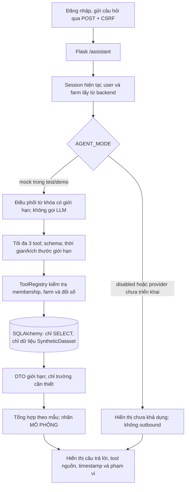

# Thiết kế AI Agent và kiểm soát an toàn

## 1. Nguyên tắc bắt buộc

1. Agent có chức năng nghiệp vụ thông qua tool thực tế, không chỉ sinh văn bản.
2. Tool chỉ đọc trong MVP; tạo/sửa dữ liệu do người dùng thực hiện qua giao diện chuẩn. Không cấp quyền SQL, shell, filesystem hoặc mạng tùy ý cho LLM.
3. Mỗi tool có schema đầu vào/đầu ra, kiểm tra permission cụ thể của user hiện hành, ràng buộc farm scope, giới hạn kết quả, kiểm thử độc lập và audit.
4. LLM không phải nguồn sự thật: số liệu phải lấy từ tool; phản hồi nêu rõ tool/dữ liệu và thời điểm truy vấn khi phù hợp.
5. Không chẩn đoán bệnh chắc chắn, kê thuốc, liều dùng hoặc thay thế bác sĩ thú y. Với dấu hiệu khẩn cấp, hướng dẫn liên hệ chuyên gia thú y; không trì hoãn chăm sóc.
6. Dữ liệu trang trại là dữ liệu không đáng tin như nội dung chỉ dẫn. Nội dung ghi chú không được phép ghi đè system policy hoặc mở thêm quyền.
7. Môi trường dùng dữ liệu thật không gọi LLM ngoài cho đến khi provider, chính sách lưu trữ và biện pháp bảo vệ được duyệt. Mock mode chỉ dùng fixture tổng hợp trong test/demo, có nhãn rõ và không được giả danh LLM thật.
8. Thiếu cấu hình/duyệt, provider lỗi, schema sai, tool bị từ chối hoặc hết thời gian phải trả lỗi tường minh; không bịa câu trả lời hoặc giả vờ đã truy vấn.

## 2. Luồng xử lý

`farm_id` và `actor_user_id` lấy từ `g.farm`/`g.user`, không từ form. Mỗi lần gọi tool chạy `require_farm_member` và xác minh farm đang hoạt động. Chỉ owner/care_staff có membership hoạt động mới đọc được; không có quyền hỗ trợ Admin hoặc grant trong Agent. Chế độ mock chỉ hoạt động với `APP_ENV=test|demo`, đồng thời mọi query lọc theo `synthetic_dataset_id` đã đăng ký cho cùng farm. `AGENT_MODE=provider` hiện không có provider thật và bị fail-closed. Không lưu lịch sử hội thoại.

## 3. Tool registry MVP

Danh sách dưới đây là tool đã triển khai trong Lát 4. Mọi schema dùng `additionalProperties: false`; giới hạn mặc định 10 và tối đa 10 bản ghi mỗi danh sách. Client không thể chọn farm hoặc nâng giới hạn.

| Tool | Mục đích | Schema đầu vào (JSON) | Phạm vi/quyền | Giới hạn và đầu ra |
|---|---|---|---|---|
| `get_farm_overview` | Tổng số vật nuôi, đàn/lô và cá thể đang theo dõi | `{}` | Owner/care_staff đang là thành viên hoạt động của farm hiện tại | Trả tổng hợp scalar; cá thể trong đàn được tính đúng một lần, đàn/cá thể không hoạt động bị loại |
| `list_barns` | Chuồng và sức chứa hiện tại | `{"limit": integer 1..10}` | Cùng phạm vi farm hiện tại | Tối đa 10 chuồng tổng hợp; hiện tại/sức chứa theo số đầu con |
| `get_feed_inventory` | Tồn thức ăn theo kg | `{"limit": integer 1..10}` | Cùng phạm vi farm hiện tại | Tối đa 10 mặt hàng tổng hợp; lấy balance hiện tại, không ghi giao dịch |
| `get_vaccination_schedule` | Lịch sắp đến hạn/quá hạn và outcome nếu có | `{"limit": integer 1..10}` | Cùng phạm vi farm hiện tại | Tối đa 10 lịch trong 30 ngày tới hoặc quá hạn; `schedule_status`, `due_status`, `outcome` và `result_recorded` là các trường riêng |
| `list_open_alerts` | Cảnh báo chưa đóng | `{"limit": integer 1..10}` | Cùng phạm vi farm hiện tại | Tối đa 10 cảnh báo; title/description được cắt độ dài; không ghi chú/xác nhận/đóng |
| `get_health_history` | Ghi nhận quan sát sức khỏe theo mã cá thể/tên đàn | `{"target": string 1..100, "limit": integer 1..10}` (`target` bắt buộc) | Đối tượng phải là bản ghi tổng hợp cùng farm; tên đàn mơ hồ bị từ chối | Tối đa 10 bản ghi, tối đa 1.000 ký tự mỗi observation; dữ liệu gốc được gắn nhãn là ghi nhận, không phải chẩn đoán |

### Quy tắc schema chung

- Từ chối field không biết, kiểu sai, chuỗi rỗng/quá dài và limit ngoài phạm vi; không có date hoặc status do client tùy chọn.
- Đầu ra là DTO rõ trường, không trả ORM object hoặc SQL.
- Runtime giới hạn câu hỏi 2.000 ký tự, tối đa 3 tool call và 8.000 ký tự kết quả; kiểm tra elapsed budget 5 giây giữa các lần gọi. Đây chưa phải cơ chế hủy tức thì một câu SQL đang chạy.
- Từ chối khi membership/farm không hợp lệ, không tiết lộ đối tượng thuộc farm khác.
- Admin nền tảng không mặc nhiên có quyền gọi tool trang trại. Mặc định authority/grant chưa được kích hoạt. Chỉ cho phép đọc khi authority độc lập đã được chỉ định/audit phê duyệt grant có scope, farm, thời hạn, lý do, người cấp/nhận và trạng thái còn hiệu lực; requester khác approver, issuer khác recipient. Backend từ chối khi authority chưa được xác minh; kiểm tra lại mỗi request và audit yêu cầu, cấp, sử dụng, từ chối, hết hạn và thu hồi. Không có cơ chế khẩn cấp tự nâng quyền; không cho self-grant/self-approval, ghi dữ liệu, quản lý tài khoản hoặc truy cập secrets.
- Tool không có quyền ghi/xác nhận thay người dùng. Staff có thể acknowledge cảnh báo và ghi outcome tiêm/tiêu thụ thức ăn qua UI/API nghiệp vụ theo permission, nhưng Agent chỉ đọc. Alert close/reopen, lịch tiêm, nhập/điều chỉnh kho, capacity request/approval, lifecycle event và health threshold đều không được thực hiện qua Agent trong MVP.
- Chỉ mở rộng tool ghi sau khi có quyết định sản phẩm riêng: tạo bản nháp, hiển thị diff, xác nhận người dùng, kiểm tra quyền lần cuối, idempotency và audit.

## 4. Quyền dữ liệu và riêng tư

**Trạng thái hiện tại sau Lát 4:** Tool registry, điều phối mock, route `/assistant` và UI đã được triển khai. Không có LLM provider, outbound call hoặc lưu hội thoại. `AGENT_MODE` mặc định `disabled`; `mock` chỉ hợp lệ trong `APP_ENV=test|demo` và chỉ truy vấn hàng có marker `SyntheticDataset` thuộc farm hiện tại.

- Không gửi dữ liệu thật ra ngoài ở MVP cho đến khi nhà cung cấp, chính sách lưu trữ, vị trí xử lý, mục đích và biện pháp bảo vệ được duyệt. Chỉ gửi dữ liệu tối thiểu sau phê duyệt; không gửi hash mật khẩu, email nhân viên, token hoặc thông tin không liên quan.
- Cấu hình provider/API key qua môi trường bí mật; không render key vào browser, log hoặc error message.
- Có giới hạn câu hỏi, số tool call, kết quả và elapsed budget; hiện chưa có rate limit đăng nhập/request theo user/farm.
- Mock mode dùng điều phối quy tắc có giới hạn, không phải LLM/fake provider. Mỗi tool truy vấn DB theo farm hiện tại nhưng lọc bắt buộc marker synthetic đã đăng ký. Không có seed tự động hay tài khoản mặc định. Chế độ này không truy cập hàng không được đánh dấu tổng hợp và không có outbound network code.
- Xác định trước provider có lưu dữ liệu, vị trí xử lý, thời hạn lưu và quyền sử dụng. Nếu chưa được duyệt, không gửi dữ liệu thật tới provider.
- Prompt/system policy không thể thay thế authorization trong code. Kết quả tool cần ranh giới dữ liệu và escaping khi hiển thị.
- Retention cấu hình riêng theo data category: audit log 365 ngày, hội thoại AI 90 ngày trong demo; không phải kết luận pháp lý. Owner xem audit trong farm; user chỉ xem hội thoại của mình; admin chỉ xem audit theo grant hợp lệ. Admin nền tảng cấu hình policy nhưng không được purge. Purge disabled ở backend; không lập lịch hoặc thực thi cho đến khi lịch, backup/restore và hold được phê duyệt. Khi được duyệt, chỉ job identity riêng với quyền tối thiểu mới chạy; ghi cấu hình, phiên chạy, kết quả/lỗi đã redacted và hỗ trợ retry an toàn.
- Hội thoại/feedback không lưu lâu hơn policy; chỉ lưu nội dung nếu cần và đã được duyệt. Nếu không cần nội dung, lưu metadata đã redacted hoặc không lưu.

## 5. Fallback, lỗi và trải nghiệm

| Tình huống | Hành vi |
|---|---|
| Agent tắt/provider chưa được triển khai | UI báo chưa khả dụng; không gọi outbound. |
| Mock không được bật ở test/demo | Cấu hình bị từ chối lúc tạo ứng dụng; mock không chạy trên APP_ENV khác. |
| Tool schema hoặc membership/farm lỗi | Từ chối tool với thông báo an toàn; farm/user luôn lấy từ backend. Không có provider để nhận dữ liệu bị chặn. |
| Tool không có dữ liệu tổng hợp | Nêu rõ thiếu dữ liệu tổng hợp; không tạo số liệu giả. |
| Dấu hiệu sức khỏe nghiêm trọng/câu hỏi điều trị | Không kết luận bệnh/kê thuốc; khuyến nghị liên hệ bác sĩ thú y, nêu giới hạn và hiển thị dữ liệu quan sát nếu có quyền. |
| DB không khả dụng | Route trả thông báo chung, không hiển thị exception/SQL details; server log chỉ ghi loại lỗi, không ghi câu hỏi hoặc nội dung kết quả. |

## 6. Kiểm thử riêng cho từng tool

Với từng tool trong registry, có tối thiểu các ca:

1. Từng tool với schema hợp lệ/sai, row cap và farm hiện tại.
2. User chưa đăng nhập bị chặn ở route; user không phải active farm member bị tool từ chối.
3. Farm khác và object ID ngoài phạm vi không trả dữ liệu.
4. Mock chỉ lấy hàng synthetic; truy vấn không sửa bảng hoặc ledger.
5. Overview/barn occupancy với đàn, cá thể đã định danh và cá thể độc lập không đếm trùng.
6. Lịch tiêm dự kiến và mọi outcome thực tế là trường riêng; `needs_verification` không trở thành đã tiêm.
7. Prompt injection trong observation chỉ được hiển thị như dữ liệu người dùng ghi; không đổi quyền hoặc gọi thêm tool.
8. Empty data, mode/provider chưa cấu hình, CSRF, lỗi DB và log không chứa secret/question.
9. Yêu cầu Agent ghi tồn kho, đóng cảnh báo hoặc thay đổi nghiệp vụ phải bị từ chối; Agent không có tool ghi.
10. Purge qua API/UI/user/admin khi disabled phải bị từ chối, không xóa dữ liệu; chưa có job identity/lịch purge được phê duyệt.

Unit test tool service dùng dữ liệu fixture tổng hợp. Integration test xác minh query/constraint với MySQL; SQLite chỉ dùng nếu behavior tương đương đã được chứng minh.

## 7. Lát 5 — Seed demo và đánh giá

- `seed-demo` chỉ chạy tường minh. Test guard yêu cầu `APP_ENV=test`, `TESTING=True` và SQLite in-memory; demo yêu cầu `APP_ENV=demo`, `AGENT_MODE=mock`, MySQL riêng với database name khớp URL/config/confirmation, UUID khớp `@@server_uuid` và operator attestation chính xác.
- Guard xác minh target trước mọi truy vấn marker hoặc nghiệp vụ. Seed kiểm tra schema đã migrate, từ chối bảng nghiệp vụ đã có dữ liệu, yêu cầu mật khẩu do operator nhập, gắn marker/version dataset và kiểm tra số lượng tạo ra trong transaction. Rerun hợp lệ là no-op; version/count mismatch bị từ chối, không sửa/xóa. Không chạy seed/migration trong quá trình chuẩn bị Lát 5.
- Mọi tool/Agent vẫn chỉ đọc synthetic rows. Bộ tình huống tại `tests/fixtures/agent-evaluation.json` phân biệt `expected_tool_values`, `expected_interpretation`, `expected_refusal` và `expected_mock_label`; ca mock không phải đo độ chính xác LLM.
- Compose pin image MySQL `8.0.46`, dùng project/volume namespace riêng, không publish cổng DB và không tự migration/seed. Chỉ kiểm tra cấu hình YAML; không start/stop container trong Lát 5.
- Minh chứng tiêu chí 5 gồm test lỗi/rollback, cross-farm, injection fixture, tool output so với kết quả kỳ vọng, nhãn mô phỏng, lệnh test và phần người thực hiện giải thích các giới hạn. Không dùng dữ liệu thật hoặc tự tạo kết quả test/LLM.
