# Mô hình dữ liệu

## 1. Quy ước

- Mỗi bảng nghiệp vụ thuộc một trang trại có `farm_id`; mọi truy vấn đọc/ghi phải giới hạn theo trang trại được cấp quyền.
- Dùng UUID làm khóa chính cho entity mới, kể cả trong MVP một farm; `farm_id` vẫn bắt buộc cho dữ liệu nghiệp vụ để mở rộng nhiều farm.
- Thời điểm lưu ở UTC; giao diện chuyển đổi theo múi giờ cấu hình. Ngày nghiệp vụ dùng kiểu DATE khi không cần thời điểm.
- Giá trị đơn vị được lưu cùng mã đơn vị; không so sánh số lượng có đơn vị khác nhau.
- Bản ghi lịch sử sức khỏe, tiêm phòng và tồn kho không bị xóa vật lý thông thường; hủy/sửa phải để lại audit và tuân thủ quyền.
- Danh mục loài không hard-code thành enum ứng dụng. Loài mới được thêm qua `species`; giống liên kết tùy chọn với loài.
- MVP chỉ có một trang trại nhưng mọi dữ liệu nghiệp vụ đều có `farm_id`; ngoại lệ là danh mục dùng chung và cấu hình nền tảng.
- Chỉ `livestock_units` đang hiện hành (`status = active`) được cộng vào dashboard/sức chứa. Mỗi con vật thuộc đúng một đơn vị hiện hành; tách/gộp/đổi tracking cập nhật trạng thái và số lượng trong một transaction.
- Tồn thức ăn được chuẩn hóa về kg. Giao dịch lưu số lượng gốc, đơn vị, hệ số quy đổi tại thời điểm ghi và số kg quy đổi để giữ lịch sử có thể kiểm toán.
- MVP chỉ chấp nhận `kg` cho giao dịch thức ăn; conversion ngoài kg chưa được bật. Mọi thay đổi đàn/vật nuôi và kho phải qua event/ledger trong transaction, kiểm tra permission và farm scope.
- Không tự seed khi ứng dụng khởi động. Fixture chỉ được nạp khi `APP_ENV` tường minh là `test`/`demo`, database name khớp cấu hình mong đợi và identity trong database xác nhận không phải production. Dữ liệu seed có marker synthetic; thiếu/sai/mâu thuẫn cấu hình thì fail-closed. Seed lặp không sửa/xóa dữ liệu; không có reset database tự động.

## 2. ERD logic

ERD dưới đây phản ánh schema đã triển khai ở Lát 2; bảng AI, breed và rule cảnh báo sức khỏe vẫn là phần thiết kế tương lai, chưa có trong migration.

```mermaid
erDiagram
    FARMS ||--o{ USER_FARM_ROLES : scopes
    USERS ||--o{ USER_FARM_ROLES : assigned
    USERS ||--o{ USER_FARM_ROLES : creates_membership
    FARMS ||--o{ SYNTHETIC_DATASETS : labels
    USERS ||--o{ SYNTHETIC_DATASETS : creates
    FARMS ||--o{ BARNS : owns
    SYNTHETIC_DATASETS o|--o{ BARNS : marks
    FARMS ||--o{ BARN_CAPACITY_EXCEPTION_REQUESTS : scopes
    BARNS ||--o{ BARN_CAPACITY_EXCEPTION_REQUESTS : concerns
    USER_FARM_ROLES ||--o{ BARN_CAPACITY_EXCEPTION_REQUESTS : requests_or_decides
    FARMS ||--o{ HERDS : scopes
    SPECIES ||--o{ HERDS : classifies
    BARNS o|--o{ HERDS : houses
    HERDS ||--o{ ANIMALS : contains
    SPECIES ||--o{ ANIMALS : classifies
    BARNS o|--o{ ANIMALS : houses
    HERDS o|--o{ HERD_EVENTS : source_or_target
    ANIMALS o|--o{ HERD_EVENTS : concerns
    USER_FARM_ROLES ||--o{ HERD_EVENTS : records
    FARMS ||--o{ FEED_ITEMS : stocks
    FEED_ITEMS ||--o| FEED_INVENTORY_BALANCES : balance
    FEED_ITEMS ||--o{ FEED_TRANSACTIONS : moves
    HERDS o|--o{ FEED_TRANSACTIONS : consumption_for
    USER_FARM_ROLES ||--o{ FEED_TRANSACTIONS : records
    ANIMALS o|--o{ HEALTH_RECORDS : concerns
    HERDS o|--o{ HEALTH_RECORDS : concerns
    USER_FARM_ROLES ||--o{ HEALTH_RECORDS : records
    ANIMALS o|--o{ VACCINATION_SCHEDULES : scheduled
    HERDS o|--o{ VACCINATION_SCHEDULES : scheduled
    VACCINATION_SCHEDULES ||--o{ VACCINATION_SCHEDULE_EVENTS : history
    VACCINATION_SCHEDULES ||--o{ VACCINATION_OUTCOMES : results
    USER_FARM_ROLES ||--o{ VACCINATION_SCHEDULE_EVENTS : records
    USER_FARM_ROLES ||--o{ VACCINATION_OUTCOMES : records
    FARMS ||--o{ ALERTS : receives
    ANIMALS o|--o{ ALERTS : concerns
    HERDS o|--o{ ALERTS : concerns
    ALERTS ||--o{ ALERT_EVENTS : lifecycle
    USER_FARM_ROLES ||--o{ ALERT_EVENTS : records
    FARMS o|--o{ AUDIT_LOGS : scopes
    USERS o|--o{ AUDIT_LOGS : acts
    FARMS ||--o{ FARM_PERMISSION_GRANTS : scopes
    USER_FARM_ROLES ||--o{ FARM_PERMISSION_GRANTS : subject_or_grantor
    USERS ||--o{ PLATFORM_AUTHORIZATIONS : subject_or_grantor
    FARMS ||--o{ SUPPORT_ACCESS_REQUESTS : scopes
    USERS ||--o{ SUPPORT_ACCESS_REQUESTS : requests_or_decides
    SUPPORT_ACCESS_REQUESTS ||--o| SUPPORT_ACCESS_GRANTS : may_create
    USERS ||--o{ SUPPORT_ACCESS_GRANTS : admin_or_grantor
    FARMS ||--o{ SUPPORT_ACCESS_GRANTS : scopes
    USERS ||--o{ DATA_RETENTION_POLICIES : configures
```

`DATA_RETENTION_POLICIES` là cấu hình theo loại dữ liệu, không phải quan hệ sở hữu dữ liệu; trường `configured_by` tham chiếu user có quyền. Có thể lưu trữ tối thiểu hoặc không lưu nội dung hội thoại. Không lưu prompt/response thô nếu không cần; tuyệt đối không lưu thông tin bí mật.

### 2.1 Schema đã triển khai ở Lát 2

| Nhóm | Bảng | Trường/ràng buộc chính |
|---|---|---|
| Trang trại và quyền | `farms`, `users`, `user_farm_roles`, `farm_permission_grants`, `platform_authorizations` | UUID `String(36)`; membership duy nhất theo farm/user; role chỉ `owner`/`care_staff`; grant hỗ trợ chỉ có bảng lưu trữ, chưa có quy trình cấp quyền hay quyền mặc định. |
| Yêu cầu hỗ trợ | `support_access_requests`, `support_access_grants` | Scope farm, lý do/thời hạn/trạng thái và FK actor; bảng chỉ là schema, không kích hoạt quyền admin hỗ trợ. |
| Phân loại và dữ liệu demo | `species`, `synthetic_datasets` | Loài là danh mục dùng chung; registry dữ liệu tổng hợp theo farm; chưa có seed tự động. |
| Chuồng và đàn/vật nuôi | `barns`, `barn_capacity_exception_requests`, `herds`, `animals`, `herd_events` | Mọi bản ghi farm-scoped có `farm_id`; capacity dương; `Herd.unidentified_count` không âm; Animal liên kết đàn cùng farm và cùng species; capacity request snapshot không làm thay đổi occupancy. |
| Thức ăn | `feed_items`, `feed_inventory_balances`, `feed_transactions` | `Numeric(12,3)`; chỉ kg; số dư và balance trước/sau không âm; delta phải khớp loại giao dịch và balance sau; FK cùng farm. |
| Sức khỏe và tiêm | `health_records`, `vaccination_schedules`, `vaccination_schedule_events`, `vaccination_outcomes` | Health/vaccination target là đúng một Animal hoặc Herd cùng farm; lịch chỉ có `scheduled`/`cancelled`; outcome riêng với trạng thái thực hiện và yêu cầu actor/thời điểm khi `administered`; outcome correction liên kết bản ghi trước. |
| Cảnh báo/audit/retention | `alerts`, `alert_events`, `audit_logs`, `data_retention_policies` | Event gắn alert/actor cùng farm; audit có farm nullable cho sự kiện nền tảng; retention ngày dương và `purge_execution_enabled = false`. |

Tất cả khóa chính dùng UUID dạng chuỗi 36 ký tự; ràng buộc farm-scoped dùng FK kép `(farm_id, id)` hoặc `(farm_id, related_id)` để ngăn liên kết bản ghi khác farm. Migration đầu tiên cài trigger DB chặn `DELETE` trên bảng nghiệp vụ/lịch sử/audit; downgrade gỡ trigger trước khi drop bảng. `species` là danh mục dùng chung và không thuộc nhóm trigger lịch sử.

`Herd.head_count` = số con chưa định danh + số Animal active liên kết với Herd active. Dashboard phải cộng từng Animal active không thuộc Herd với tổng head_count của Herd active; không cộng đồng thời Animal thành phần riêng lần thứ hai. Service nghiệp vụ hiện ghi event cùng transaction khi tạo đàn/cá thể, nhận diện cá thể từ đàn, đổi số lượng chưa định danh, split/merge đàn, chuyển đàn/cá thể và ghi nhận bán/mất. Split đàn hiện áp dụng cho số con chưa định danh; cá thể đã định danh được chuyển riêng qua workflow cá thể. Tất cả thao tác tăng số lượng/chuyển nơi có kiểm tra capacity hiện hành; vượt capacity bị từ chối, chưa thực thi quy trình ngoại lệ.

Feed service chỉ nhận quantity chính xác theo kg, kiểm tra membership/grant ở backend, khóa mặt hàng và số dư bằng `SELECT ... FOR UPDATE`, cập nhật số dư, ledger và audit cùng transaction. Giao dịch tiêu thụ của nhân viên được phép; nhập/điều chỉnh cần owner hoặc permission grant riêng (`feed_stock_in`/`feed_adjust`). Với session đã có transaction (ví dụ request đã xác thực), service dùng savepoint để giữ thay đổi nghiệp vụ atomic trong transaction của request; caller chịu trách nhiệm commit/rollback transaction ngoài.

Kiểm thử hai giao dịch tiêu thụ đồng thời trên MySQL disposable xác nhận chỉ giao dịch đủ tồn được ghi; SQLite chỉ dùng cho kiểm thử logic/rollback và không được xem là bằng chứng khóa đồng thời tương đương MySQL.

Các bảng `breeds`, `livestock_units`, `health_alert_rules`, `feed_unit_conversions`, `ai_conversations`, `ai_messages`, `ai_tool_calls` và `admin_bootstrap_state` trong các phần dưới là định hướng thiết kế cho lát sau, chưa được tạo trong migration này.

Migration, CHECK, FK kép, trigger và downgrade đã được kiểm chứng trên MySQL disposable phiên bản 8.0.46. Kết quả này không tuyên bố hỗ trợ phiên bản MySQL khác; trước khi dùng một server/phiên bản khác cần xác minh CHECK được thực thi và chạy lại migration trên MySQL disposable tương ứng.

## 3. Data dictionary

Các bảng dưới đây mô tả data dictionary logic đích đã thiết kế. Với phần đã triển khai, dùng bảng tên/cột/ràng buộc tại mục 2.1 làm chuẩn thực tế của migration Lát 2; một số tên/field ở đây là khái niệm tương lai hoặc sẽ được triển khai ở lát sau.

### 3.1 Tài khoản và phân quyền

| Bảng | Trường chính | Ý nghĩa/ràng buộc |
|---|---|---|
| `farms` | `id`, `name`, `timezone`, `status`, `created_at` | Trang trại; `timezone` mặc định `Asia/Ho_Chi_Minh`, cấu hình được; ngày nghiệp vụ/overdue dựa trên timezone farm. |
| `users` | `id`, `email`, `password_hash`, `display_name`, `status`, `created_at`, `updated_at` | Email chuẩn hóa và duy nhất theo chính sách; không lưu mật khẩu thô. |
| `synthetic_datasets` | `id`, `marker`, `seed_version`, `created_by`, `created_at` | Registry cho bộ dữ liệu tổng hợp. Mỗi hàng nghiệp vụ do fixture tạo có `synthetic_dataset_id` FK/marker tương ứng. Chỉ nạp tường minh trong `test`/`demo` sau khi xác minh DB; không seed khi app startup, không xóa/ghi đè/reset. Seed lặp phải bỏ qua hàng synthetic tương đương hoặc dừng khi có xung đột; không sửa hàng có sẵn. |
| `user_farm_roles` | `user_id`, `farm_id`, `role`, `created_at` | Gán `owner` hoặc `care_staff` theo trang trại; duy nhất theo user/farm/role phù hợp. Mỗi action vẫn được kiểm tra theo permission ở backend. |
| `farm_permission_grants` | `id`, `user_id`, `farm_id`, `permission_code`, `granted_by`, `granted_at`, `revoked_at` nullable, `reason` | Owner cấp/thu hồi permission chức năng hẹp cho delegate (ví dụ `barn_capacity_request`, `barn_capacity_approve`, `vaccination_schedule_manage`, `alert_close_reopen`, `feed_stock_in`, `feed_adjust`, `health_rule_manage`). Kiểm tra farm, action và hiệu lực mỗi request; không tự cấp quyền; mọi thay đổi audit. Quyền request và approve capacity là riêng; requester không tự approve. |
| `system_admins` hoặc claim tương đương | `user_id`, `enabled`, `granted_at` | Vai trò quản trị nền tảng riêng, không kế thừa quyền nghiệp vụ trang trại. |
| `platform_authorizations` | `id`, `user_id`, `permission_code`, `granted_by`, `granted_at`, `revoked_at` nullable | Quyền nền tảng độc lập với `system_admins`; các permission `support_grant_approve`/`support_grant_revoke` mới có quyền quyết định grant hỗ trợ. Không tạo sẵn authority/tài khoản/quyền; chỉ kích hoạt sau quy trình chỉ định độc lập được phê duyệt và audit. Admin nền tảng không tự gán quyền này cho mình; nếu authority chưa được xác minh thì backend từ chối grant. |
| `support_access_requests` | `id`, `admin_user_id`, `farm_id`, `requested_scope`, `reason`, `requested_starts_at`, `requested_expires_at`, `status`, `requested_at`, `decided_by` nullable, `decision_reason` nullable, `decided_at` nullable | `status`: `pending`, `approved`, `denied`, `cancelled`, `expired`. Yêu cầu không cấp quyền tức thời. Chỉ principal có `support_grant_approve` độc lập mới quyết định; người gửi không tự duyệt yêu cầu của mình. Nếu authority chưa được xác minh thì từ chối; không có cơ chế khẩn cấp tự nâng quyền. Từ chối/thu hồi/hết hạn được lưu/audit. Scope chỉ bao gồm dữ liệu farm tối thiểu cần hỗ trợ. |
| `support_access_grants` | `id`, `request_id`, `admin_user_id`, `farm_id`, `scope`, `reason`, `granted_by`, `starts_at`, `expires_at`, `status`, `revoked_by` nullable, `revoked_at` nullable | Mặc định không có grant. Chỉ đọc, đúng farm/dữ liệu, có người cấp/nhận, lý do và thời hạn; `granted_by != admin_user_id`. Chỉ authority độc lập đã kích hoạt mới được cấp/thu hồi. Backend kiểm tra ở mọi request; thu hồi/hết hạn/sai scope bị từ chối. Audit yêu cầu/cấp/từ chối/sử dụng/thu hồi. Không mở quyền ghi, quản lý tài khoản hoặc secrets. |
| `admin_bootstrap_state` | `id` (singleton), `completed_at`, `completed_by` | Chỉ tạo khi admin đầu tiên được tạo thành công. Lệnh bootstrap kiểm tra admin hiện có và state, tạo user/state atomically; lần thứ hai từ chối. Lỗi giữa chừng rollback cả hai. Bí mật lấy từ prompt an toàn hoặc environment, không log/source/seed/Git. |

### 3.2 Loài, nơi ở và vật nuôi

| Bảng | Trường chính | Ý nghĩa/ràng buộc |
|---|---|---|
| `species` | `id`, `code`, `name_vi`, `name_scientific` nullable, `active` | Danh mục mở rộng: bò, lợn, gia cầm có thể là bản ghi danh mục; chưa gán dữ liệu mặc định ngoài bộ demo được duyệt. |
| `breeds` | `id`, `species_id`, `name`, `active` | Giống tùy chọn; giống phải thuộc cùng loài của đối tượng. |
| `barns` | `id`, `farm_id`, `name`, `location_note`, `capacity_heads`, `status` | Ngưỡng sức chứa cấu hình theo đầu con. Occupancy tính tổng `head_count` của đơn vị hiện hành trong chuồng; chuyển vào gây vượt ngưỡng thì cảnh báo và mặc định từ chối nếu không có ngoại lệ hợp lệ. Không giả định một chuồng chỉ chứa một loài. |
| `livestock_units` | `id`, `farm_id`, `species_id`, `breed_id` nullable, `barn_id` nullable, `tracking_mode`, `identifier` nullable, `display_name` nullable, `head_count`, `sex` nullable, `birth_date` nullable, `acquired_at` nullable, `status`, `created_at`, `updated_at` | `tracking_mode` là individual/group. Cá thể phải có `head_count = 1`; đàn/lô phải có số nguyên dương. Bò/lợn demo ưu tiên cá thể; gia cầm ưu tiên đàn/lô nhưng hỗ trợ cá thể. Chỉ `active` được tính hiện trạng; `split`, `merged`, `closed` không tính. |
| `livestock_unit_events` | `id`, `farm_id`, `source_unit_id` nullable, `target_unit_id` nullable, `event_type`, `head_count`, `occurred_at`, `reason`, `recorded_by` | Nhật ký bất biến cho nhập đàn, tách, gộp, chuyển cá thể/đàn, tăng/giảm số lượng hoặc đóng tracking. Mọi thay đổi số lượng hiện hành phải đi qua event và cập nhật source/target trong cùng transaction; tổng con trước/sau phải bảo toàn trừ acquisition/birth/loss/sale/adjustment có lý do. Không cho tạo đơn vị mới từ con đã nằm trong group nếu không có event chuyển/tách giảm source. |
| `barn_capacity_exception_requests` | `id`, `farm_id`, `barn_id`, `current_occupancy_heads`, `capacity_heads_snapshot`, `proposed_additional_heads`, `reason`, `requested_by`, `requested_at`, `decision`, `decided_by` nullable, `decision_reason` nullable, `decided_at` nullable, `expires_at` nullable, `executed_at` nullable | `decision`: `pending`, `approved`, `rejected`, `cancelled`, `expired`. Chỉ owner/delegate có permission gửi request hoặc duyệt; nhân viên chăm sóc và admin nền tảng không mặc nhiên được gửi/duyệt. Người gửi không tự duyệt. Request không đổi capacity/headcount. Khi thực thi phải khóa chuồng, tính lại occupancy/capacity và dùng transaction; snapshot cũ/hết hạn/chưa duyệt bị từ chối. Mọi bước có lý do và audit. |

### 3.3 Sức khỏe và tiêm phòng

| Bảng | Trường chính | Ý nghĩa/ràng buộc |
|---|---|---|
| `health_records` | `id`, `farm_id`, `livestock_unit_id`, `recorded_at`, `observations`, `action_taken` nullable, `follow_up_at` nullable, `recorded_by`, `created_at` | Ghi nhận quan sát do người dùng nhập; không phải kết luận tự động của hệ thống. |
| `vaccination_schedules` | `id`, `farm_id`, `livestock_unit_id`, `vaccine_name`, `due_at`, `status`, `assigned_to` nullable, `created_by`, `updated_by`, `change_reason`, `created_at`, `updated_at`, `cancelled_at` nullable | Owner/delegate có permission tạo/sửa/hủy lịch và phân công người thực hiện; mọi thay đổi có actor/thời điểm/lý do. Chỉ người có quyền phù hợp được sửa lịch đã có kết quả thực tế; lịch sử đầy đủ được giữ ở `vaccination_schedule_events`. Lịch quá hạn là trạng thái lịch suy ra theo due date và timezone farm, không chứng minh đã/chưa tiêm. |
| `vaccination_schedule_events` | `id`, `farm_id`, `schedule_id`, `event_type`, `before_snapshot`, `after_snapshot`, `reason`, `actor_user_id`, `occurred_at` | Append-only history cho tạo/sửa/hủy/phân công lịch; lưu người thao tác, thời điểm, lý do và trạng thái trước/sau. Không xóa cứng hoặc ghi đè lịch sử khi correction. |
| `vaccination_outcomes` | `id`, `farm_id`, `schedule_id`, `outcome`, `occurred_at` nullable, `performed_by` nullable, `recorded_by`, `notes` nullable, `created_at`, `supersedes_id` nullable | Nhân viên được xem lịch và ghi nhận kết quả thực tế `administered`, `not_performed`, `postponed` hoặc `needs_verification`; không được khai báo đã tiêm khi chưa thực hiện/có căn cứ. Kết quả không được sửa/xóa cứng; correction có quyền riêng và giữ lịch sử. `overdue` không phải outcome: hiển thị riêng khi due date đã qua và chưa có kết quả `administered`; không ghi đè `postponed`/`needs_verification`. |
| `health_alert_rules` | `id`, `farm_id`, `name`, `condition_config`, `source_reference` nullable, `approval_note` nullable, `approved_by`, `approved_at`, `active` | Ngưỡng y tế mặc định không bật. Chỉ kích hoạt sau xác nhận của principal có quyền và có `source_reference` hoặc `approval_note`; ghi audit. AI không tạo/sửa quy tắc/ngưỡng. |

### 3.4 Thức ăn và cảnh báo

| Bảng | Trường chính | Ý nghĩa/ràng buộc |
|---|---|---|
| `feed_items` | `id`, `farm_id`, `name`, `base_unit_code`, `low_stock_threshold_kg` nullable, `active` | Đơn vị chuẩn cố định là `kg`; ngưỡng tồn kho cũng tính theo kg và do người có quyền cấu hình. |
| `feed_unit_conversions` | `id`, `farm_id`, `feed_item_id`, `unit_code`, `kg_per_unit`, `approved_by`, `approved_at`, `reason`, `active`, `created_at` | Chưa được dùng trong MVP: chỉ `kg` được chấp nhận. Trong tương lai, owner/delegate có permission duyệt từng hệ số trước khi dùng; lịch sử hệ số đã dùng không sửa hồi tố. |
| `feed_transactions` | `id`, `farm_id`, `feed_item_id`, `transaction_type`, `quantity_entered`, `entered_unit_code`, `kg_per_unit_snapshot`, `conversion_version` nullable, `quantity_kg`, `balance_before_kg`, `balance_after_kg`, `occurred_at`, `livestock_unit_id` nullable, `reference` nullable, `reason` nullable, `recorded_by`, `created_at` | MVP kiểm tra `entered_unit_code = kg`; `quantity_kg` dương, dấu lấy từ loại giao dịch. Dùng số học fixed-point/DECIMAL, không dùng float; độ chính xác/làm tròn cần chốt trước khi bật conversion ngoài kg. Snapshot tương lai gồm đơn vị gốc, số lượng, hệ số, kg quy đổi và version, giữ nguyên lịch sử. Nhân viên chỉ ghi tiêu thụ; owner/delegate có permission được nhập kho/điều chỉnh, adjustment bắt buộc lý do và số dư trước/sau. Không xóa cứng. Khóa/transaction bảo đảm không tồn âm kể cả đồng thời; lỗi rollback toàn bộ. |
| `alerts` | `id`, `farm_id`, `alert_type`, `severity`, `title`, `description`, `livestock_unit_id` nullable, `feed_item_id` nullable, `health_alert_rule_id` nullable, `status`, `created_at` | Trạng thái `new`, `acknowledged`, `in_progress`, `closed`; cảnh báo sức khỏe tham chiếu rule đã duyệt, không thay chẩn đoán. Staff được acknowledge/thêm ghi chú nhưng không close; owner/delegate có permission close/reopen với lý do và kết quả. |
| `alert_events` | `id`, `farm_id`, `alert_id`, `event_type`, `actor_user_id`, `reason` nullable, `note` nullable, `occurred_at` | Lịch sử append-only cho acknowledge, ghi chú, xử lý, close và reopen; lưu actor/thời điểm/lý do. Acknowledge không đồng nghĩa đã giải quyết. |

### 3.5 Audit và AI

| Bảng | Trường chính | Ý nghĩa/ràng buộc |
|---|---|---|
| `audit_logs` | `id`, `farm_id` nullable, `actor_user_id` nullable, `action`, `entity_type`, `entity_id` nullable, `outcome`, `request_id`, `occurred_at`, `metadata_redacted` | Chỉ metadata tối thiểu đã lọc; không ghi mật khẩu, session/token, API key hoặc payload nhạy cảm. Hạn chế sửa/xóa. |
| `ai_conversations` | `id`, `user_id`, `farm_id`, `created_at`, `closed_at` nullable | Tham chiếu hội thoại; farm scope chốt khi tạo, kiểm tra lại mỗi tool call. Chính sách lưu/xóa cần duyệt. |
| `ai_messages` | `id`, `conversation_id`, `role`, `content_redacted` nullable, `created_at`, `status` | Lưu tối thiểu hoặc chỉ giữ metadata tùy chính sách; loại bỏ bí mật và dữ liệu không cần thiết. |
| `ai_tool_calls` | `id`, `message_id`, `tool_name`, `arguments_validated_redacted`, `status`, `duration_ms`, `result_summary_redacted`, `created_at` | Audit tool name, kết quả và lỗi ở mức tối thiểu; không lưu kết quả dữ liệu cá thể nếu không cần. |
| `data_retention_policies` | `id`, `data_category`, `retention_days`, `enabled`, `purge_execution_enabled`, `configured_by`, `updated_at` | Giá trị demo audit 365 ngày, hội thoại AI 90 ngày; không phải kết luận pháp lý. Policy không tự kích hoạt xóa. `purge_execution_enabled` mặc định false; user/owner/admin không gọi purge. Chỉ job identity riêng sau khi lịch chạy, backup/restore và hold được phê duyệt; job kiểm tra điều kiện trước khi chạy, ghi audit kết quả/lỗi và hỗ trợ retry an toàn. Người dùng chỉ xem hội thoại của mình; owner xem audit farm; nhân viên không đọc audit; admin chỉ đọc audit theo grant hợp lệ. |

## 4. Ràng buộc và chỉ mục đề xuất

- Unique: `users.email` sau chuẩn hóa; `species.code`; `breeds(species_id, name)`; `livestock_units(farm_id, identifier)` khi identifier khác null; conversion theo item/unit chỉ có một bản ghi active.
- FK: tất cả quan hệ nghiệp vụ; đảm bảo `farm_id` nhất quán giữa bản ghi cha/con bằng service hoặc ràng buộc phù hợp.
- Chỉ mục theo truy vấn: `(farm_id, status)`, `(farm_id, species_id, status)`, `(farm_id, barn_id, status)`, `(farm_id, occurred_at)`, `(farm_id, scheduled_at)`, `(farm_id, feed_item_id, occurred_at)`, `(farm_id, alert status, created_at)`.
- Số lượng đầu con dương; individual có đúng 1; group có số nguyên dương. Dashboard chỉ tổng hợp đơn vị `active`; chuyển trạng thái và số lượng khi tách/gộp trong transaction để một con không xuất hiện ở cả nguồn lẫn đích. Kiểm tra invariant tổng đầu con trước/sau; sự kiện tăng/giảm yêu cầu lý do.
- Lifecycle vật nuôi/đàn: acquisition/birth/split/merge/movement/tracking conversion/loss phải ghi event và cập nhật trạng thái/số lượng cùng transaction. Rollback toàn bộ khi bước nào lỗi; dùng khóa/kiểm soát concurrency để giữ invariant, ngăn số lượng âm và ngăn cùng con được đại diện bởi cá thể active lẫn đàn active.
- Giao dịch kho: chỉ `kg` trong MVP; khóa dòng mặt hàng (hoặc balance) trước khi tính tồn, xác minh đủ tồn và ghi transaction trong cùng DB transaction. Chỉ commit nếu tồn mới không âm; rollback toàn bộ nếu không đủ. Mỗi transaction ghi do actor có permission; nhân viên chỉ tiêu thụ, owner/delegate mới nhập/điều chỉnh theo quyền riêng.
- Chuồng: occupancy = tổng `head_count` của đơn vị active đang ở chuồng. Khóa chuồng trong transaction khi thêm/chuyển để tránh đồng thời vượt capacity. Vượt capacity phát cảnh báo và mặc định chặn. Chỉ owner/delegate có permission được tạo request/phê duyệt; người gửi không tự duyệt, request không tự thực thi. Ghi snapshot, lý do, actor và thời điểm; tính lại capacity khi thực thi. Không cho AI gửi/duyệt/thực hiện.
- Ngưỡng sức khỏe chỉ được kích hoạt khi có `source_reference` hoặc xác nhận của người có thẩm quyền; không tự đặt ngưỡng y tế.
- Tách lịch tiêm khỏi outcome thực tế. Owner/delegate có permission quản lý lịch; nhân viên ghi outcome thực tế có căn cứ. `overdue` là cờ lịch suy ra theo due date/timezone nếu chưa có outcome administered; không ghi đè outcome hoãn/cần xác minh. Mọi sửa lịch sau khi có outcome phải giữ history. Không đặt ngưỡng tuổi/liều/y tế khi chưa có nguồn duyệt.
- Cảnh báo lưu event history; staff chỉ acknowledge/thêm ghi chú, owner/delegate có permission close/reopen. Mọi thay đổi trạng thái có actor/thời điểm; close/reopen cần lý do và kết quả.
- Xóa danh mục đã được tham chiếu nên là ngừng hoạt động, không cascade xóa lịch sử.
- Purge retention bị vô hiệu hóa ở backend; không lập lịch hoặc thực thi khi chưa có phê duyệt vận hành. Khi được duyệt trong tương lai, chỉ job identity riêng sau khi kiểm tra lịch chạy, backup/restore và hold mới xử lý category được phép; audit kết quả/lỗi và hỗ trợ retry an toàn. Không có API purge cho user/owner/admin thông thường. 365/90 ngày chỉ là cấu hình demo.

## 5. Giới hạn đã chốt và điểm hoãn an toàn

1. Grant hỗ trợ vẫn disabled; không tạo sẵn authority/tài khoản/quyền. Chỉ kích hoạt sau khi tổ chức chỉ định authority độc lập có audit; admin không tự gán quyền/tự duyệt, requester không tự duyệt, người cấp khác người nhận.
2. Purge vẫn disabled ở backend; không user/owner/admin nào được gọi. Chỉ xem xét bật sau khi lịch chạy, backup/restore và hold được phê duyệt; job identity riêng, retry an toàn, audit kết quả/lỗi.
3. Fixture/seed không chạy khi app startup. Chỉ chạy tường minh trong `test`/`demo`, xác minh database identity và cấu hình không phải production; marker synthetic trên mọi hàng; mismatch/missing/production bị từ chối; chạy lặp không xóa/ghi đè, không có reset tự động.
4. Độ chính xác/làm tròn cho conversion ngoài kg được hoãn; MVP chỉ kg và không có conversion code/path được bật.
5. Provider LLM thật, chính sách lưu trữ/vị trí xử lý và biện pháp bảo vệ được hoãn; không gửi dữ liệu thật ra ngoài.

Các quyền nhân viên, lịch tiêm, acknowledgement/đóng cảnh báo, giao dịch thức ăn, capacity, retention access, kg-only và ranh giới tính năng hoãn đã được chốt và có test tương ứng trong acceptance-and-test-plan.md.

## 6. Đối chiếu schema đã có với workflow Lát 3

Lát 3 không đổi schema và không thêm migration. Ứng dụng sử dụng các model thực tế sau:

- `User.password_hash`, `User.status` và `FarmMembership(farm_id, user_id, role)` phục vụ đăng nhập và phạm vi phiên; mật khẩu do CLI provisioning hash bằng helper Werkzeug. Không có tài khoản mặc định hoặc quyền platform admin mới.
- `BarnService` kiểm tra occupancy từ đàn active và cá thể active độc lập; cá thể gắn đàn không được cộng thêm lần nữa. Khi cập nhật capacity, backend từ chối nếu capacity mới thấp hơn occupancy.
- `LivestockService` tiếp tục chịu trách nhiệm tạo/định danh/chuyển đàn, chuyển cá thể và bán/mất; metadata update được audit. Route không ghi trực tiếp `Herd`/`Animal`.
- `FeedInventoryService` tiếp tục là đường ghi duy nhất cho danh mục và giao dịch kho trên web. Danh mục mới tạo balance 0 kg; receipt/adjustment dựa vào permission service, consumption không thể làm tồn âm.
- `VaccinationScheduleEvent` lưu snapshot tạo/sửa/hủy lịch; `VaccinationOutcome` là bảng riêng. Một lịch chỉ được ghi một outcome trong workflow hiện tại; correction chưa bật vì cần policy/permission riêng.
- `HealthRecord` và `AlertEvent` được append qua workflow có farm/actor và audit. Cảnh báo không tự sinh theo ngưỡng y tế; staff không đóng cảnh báo, audit UI owner-only.

Các giới hạn triển khai hiện tại: `species` là danh mục dùng chung chưa có UI; không thêm dữ liệu loài mặc định. Không có UI quản lý thành viên, quy trình chỉnh sửa kết quả tiêm, capacity exception, hoặc reopen alert. Các giới hạn này không được diễn giải là đã đáp ứng toàn bộ workflow thiết kế tương lai.
